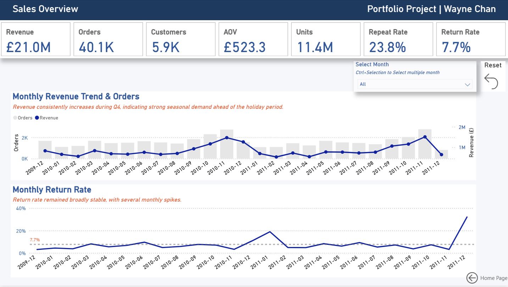

# UK Retail Analytics Dashboard

## Project Title

UK Retail Analytics Dashboard - Commercial Performance Case Study

## Business Problem

This project analyses UK online retail transactions to help a commercial team understand revenue performance, customer behaviour, product concentration, and returns. The objective is to turn transactional sales data into a management-ready Power BI dashboard that supports trading, merchandising, and customer retention decisions.

The dashboard is positioned as a junior data analyst / commercial analyst portfolio project, with SQL-based data preparation in BigQuery and a Power BI reporting layer.

## Key Questions Answered

- How are revenue, orders, customers, units, and average order value changing month by month?
- Which products contribute the largest share of revenue?
- How concentrated is revenue across products and customers?
- What proportion of customers place repeat orders within the same month?
- What is the monthly return rate by revenue and order count?
- Which invoice activity may represent higher-value B2B behaviour?

## Dataset Overview

- Source: Online retail transaction data loaded into Google BigQuery.
- Grain: One row per invoice line in the cleaned sales-line export.
- Date range in exported fact file: 2009-12-01 to 2011-12-09.
- Exported fact line count: 1,061,164 rows.
- Main fields used: invoice number, invoice date, customer ID, country, stock code, product description, quantity, price, revenue, return flag, and valid-sale flag.
- Dashboard extract files are stored in `view/`.
- Power BI report file is stored in `dashboard/uk_online_retail.pbix`.

## Tools Used

- Google BigQuery SQL for cleaning, modelling, KPI views, and analytical queries.
- Power BI for dashboard design, KPI reporting, and visual analysis.
- CSV exports for portfolio review and reproducibility.
- Git/GitHub for version control and project presentation.

## Data Cleaning and Transformation Summary

The SQL workflow creates a cleaned retail layer from the raw transaction table and then builds reporting-ready fact and dimension views.

- Converted invoice timestamps into transaction dates and reporting months.
- Created `is_return` to identify negative quantity transactions.
- Created `is_valid_sale` to identify positive quantity and positive price sales lines.
- Standardised missing customer IDs to `UNKNOWN` in the sales-line fact.
- Built customer and product dimensions from cleaned transaction data.
- Created invoice-level net sales logic by aggregating revenue and units by invoice, month, and customer.
- Segmented invoices as `B2B` or `Retail` using an invoice revenue threshold of GBP 50,000.
- Excluded reference stock codes from selected product concentration analysis where the SQL joins to `ref_excluded_stockcode`.

More detail is available in [docs/data_cleaning_steps.md](docs/data_cleaning_steps.md).

## Data Model Summary

The project follows a simple analytics model designed for dashboard reporting:

- `uk_retail_cleaned`: cleaned transaction layer derived from the raw BigQuery table.
- `fact_sales_line`: invoice-line fact table used for return analysis and detailed sales reporting.
- `fact_sales_net`: net sales fact table used for revenue, order, customer, and product analysis.
- `fact_invoice_net`: invoice-level aggregation used for order value and segmentation.
- `dim_customer`: customer lookup with country.
- `dim_product`: product lookup with stock code and description.
- `dim_invoice_segment`: invoice-level segment classification.
- KPI and analytics views: monthly summary, repeat rate, return rate, B2B share, product Pareto, customer ranking, and top product contribution.

## KPI Definitions

- Revenue: Sum of net sales revenue from `fact_sales_net`.
- Orders: Count of distinct invoices after invoice-level aggregation.
- Customers: Count of distinct known customers, excluding `UNKNOWN` where required by the KPI.
- Units: Sum of item quantities.
- Average Order Value (AOV): Revenue divided by orders.
- Repeat Rate: Customers with at least two invoices in a month divided by total known customers in that month.
- Return Rate by Amount: Returned revenue divided by sales revenue.
- Return Rate by Orders vs Sales Orders: Return invoices divided by sales invoices.
- Return Rate by Orders vs Total Orders: Return invoices divided by all invoices.
- Top 10 Product Contribution: Revenue share contributed by the top 10 products in each month.
- Product Revenue Concentration: Number and percentage of products required to reach approximately 80% of revenue.
- Customer Revenue Concentration: Number and percentage of customers required to reach approximately 80% of revenue.

Full definitions are documented in [docs/kpi_definitions.md](docs/kpi_definitions.md).

## Dashboard Overview

The Power BI dashboard contains four portfolio screenshots:

- Executive Summary: high-level commercial performance view.
- Overview: monthly revenue, orders, customers, units, AOV, repeat rate, and return rate.
- Product Analysis: product ranking, top product contribution, and Pareto-style revenue concentration.
- Customer Analysis: customer revenue distribution, ranking, and repeat purchase behaviour.

## Key Insights

The following insights are based on the exported files currently available in this repository:

- Analysed revenue in the customer ranking extract is GBP 17.74m.
- Revenue shows clear seasonality, with stronger trading in the final quarter and a visible peak in November 2011 at GBP 1.51m.
- Product revenue is concentrated: approximately 1,037 products out of 4,914 products, or 21.1%, contribute around 80% of product revenue.
- The top 10 products contribute 8.0% of product revenue in the product Pareto export.
- Customer revenue is concentrated: approximately 1,352 customers out of 5,878 customers, or 23.0%, contribute around 80% of known-customer revenue.
- The average monthly repeat rate in the exported repeat-rate view is 23.8%.
- B2B-segment invoices contribute 1.7% of invoice revenue in the invoice segment export.
- Returns vary by month, so both return revenue and return invoice rates should be tracked alongside sales performance.

## Business Recommendations

- Prioritise availability, merchandising, and promotional planning for the highest-revenue products, as a small share of products drives most revenue.
- Review long-tail products with low revenue contribution to identify candidates for range rationalisation, bundling, or targeted promotion.
- Develop retention activity for repeat customers and high-value customers, as customer revenue is concentrated in a relatively small customer group.
- Monitor return rate by month and product to identify quality, fulfilment, or product description issues that may be reducing net revenue.
- Separate high-value invoice behaviour from typical retail behaviour in reporting, as B2B-style orders can distort average order value and monthly trends.

## Limitations

- The raw data source is not included in the repository.
- The PBIX file contains the dashboard, but the exact Power BI data model relationships and DAX measures are not documented separately yet.
- Some business context is unknown, including margin, marketing activity, stock availability, customer acquisition source, and fulfilment costs.
- The B2B segment uses a simple invoice revenue threshold of GBP 50,000 and should be validated with business rules before operational use.
- Customer IDs marked as `UNKNOWN` are excluded from some customer KPIs, which affects repeat-rate and customer concentration analysis.
- Some KPI values depend on exported CSV snapshots, so they should be refreshed if the SQL views are updated.

More detail is available in [docs/limitations.md](docs/limitations.md).

## What I Would Improve Next

- Add a data dictionary covering each table, field, and business definition.
- Document the Power BI model relationships and any DAX measures used in the PBIX.
- Add automated data validation checks for row counts, date coverage, duplicate invoice lines, null customer IDs, negative quantities, and revenue reconciliation.
- Add margin or profit analysis if cost data becomes available.
- Add product category mapping to support category-level commercial recommendations.
- Add customer cohort analysis to distinguish new, retained, and reactivated customers.
- Publish an anonymised dashboard walkthrough or PDF export for recruiters who cannot open PBIX files.

## Portfolio Audit Summary

The project already includes a credible SQL-to-dashboard workflow, KPI views, exported data, screenshots, and a Power BI file. The main portfolio gaps before this update were documentation depth, business framing, KPI definitions, validation notes, limitations, and a change history.

The new `docs/` folder and `CHANGELOG.md` address those gaps. Remaining items to add manually are listed in the README sections above and in the supporting documentation.

## Author

Wayne Chan
