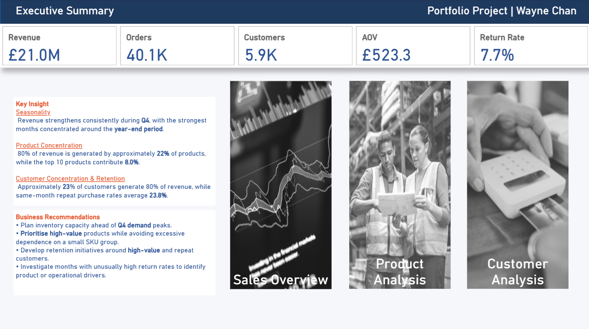
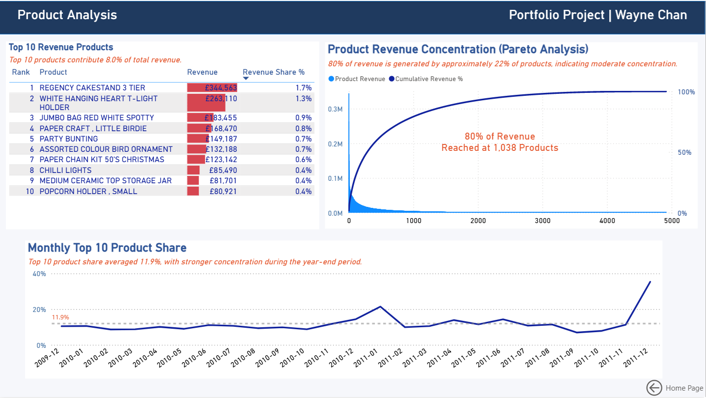
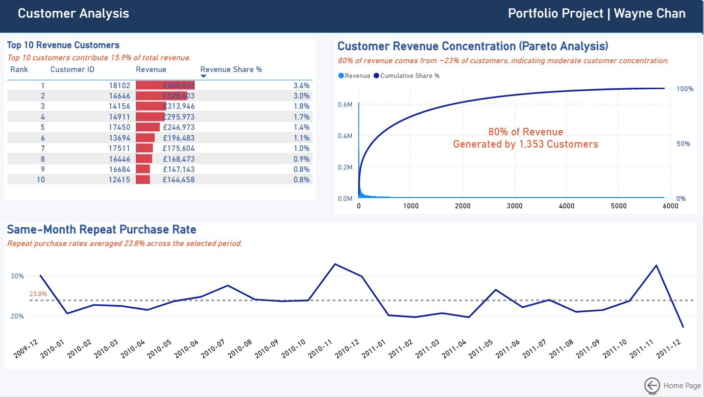

# UK Retail Analytics Dashboard

## Commercial Performance Case Study

An end-to-end retail analytics project using Google BigQuery, SQL, Power BI, DAX, and Power Query to transform transactional data into management-ready commercial insights.

The analysis covers approximately **£21.0M in revenue, 40.1K orders, and 5.9K customers**, with a focus on sales performance, seasonality, product concentration, customer behaviour, repeat purchasing, and returns.

---

## Open the report

- [Executive summary preview](images/executive_summary.png)
- [Power BI report](powerbi/UK_Retail_Analytics_Report.pbix)
- [SQL pipeline overview](sql/README.md)

To inspect the report, download the PBIX and open it in Power BI Desktop. To rerun the pipeline, obtain the original Online Retail II source separately, load it into your own BigQuery dataset and adjust the table references in the scripts. Run the staging, warehouse and mart stages in that order. The fourth SQL folder contains supplementary analysis. For a local refresh, point the Power Query sources to your CSV exports, or use the [existing processed exports](data/processed/). The historical results describe this dataset.

## Business Problem

The objective of this project is to help a commercial team understand:

- How sales performance changes over time.
- Whether demand exhibits meaningful seasonal patterns.
- Which products and customers contribute the greatest share of revenue.
- How concentrated the business is across its product and customer base.
- How frequently customers make repeat purchases within the same month.
- How return behaviour changes over time.

The final output is an interactive four-page Power BI dashboard designed to translate transactional data into actionable commercial insights and recommendations.

---

## Key Questions

- How are revenue, orders, customers, units, and average order value changing over time?
- Which products generate the most revenue?
- How concentrated is product revenue?
- Which customers generate the most revenue?
- How concentrated is customer revenue?
- What proportion of customers place multiple orders within the same month?
- How does return activity vary over time?
- What commercial actions can be supported by these findings?

---

## Dataset Overview

- **Source:** Online retail transaction dataset loaded into Google BigQuery.
- **Date range:** 1 December 2009 to 9 December 2011.
- **Transaction lines:** 1,061,164 rows in the exported sales-line fact dataset.
- **Main fields:** Invoice, Invoice Date, Customer ID, Country, Stock Code, Product Description, Quantity, Price, Revenue, Return Flag, and Valid Sale Flag.
- **Reporting layer:** SQL-generated analytical tables exported for Power BI.
- **Power BI report:** `powerbi/UK_Retail_Analytics_Report.pbix`

The raw source dataset is not included in the repository.

---

## Tools & Skills

- **Google BigQuery / SQL** — data cleaning, transformation, aggregation, KPI preparation, and analytical queries.
- **Power BI** — semantic modelling, interactive reporting, dashboard design, and visual analysis.
- **DAX** — filter-aware measures, dynamic KPIs, labels, and reporting logic.
- **Power Query** — report-layer data preparation.
- **Git / GitHub** — version control and project documentation.

---

## Data Preparation & Transformation

The SQL workflow transforms raw transaction data into reporting-ready analytical tables.

Key preparation steps include:

- Converted invoice timestamps into reporting dates and months.
- Identified return transactions using negative quantities.
- Created valid-sale logic for positive quantity and positive price transactions.
- Standardised missing customer IDs as `UNKNOWN` where appropriate.
- Built customer and product dimensions.
- Aggregated invoice-level revenue and units.
- Created monthly KPI datasets for revenue, orders, customers, units, and AOV.
- Calculated same-month repeat purchase rates.
- Calculated monthly return metrics.
- Built product and customer revenue concentration datasets.
- Created Top 10 product contribution analysis.
- Excluded selected reference stock codes from product concentration analysis where appropriate.

Detailed methodology is available in
[docs/data_cleaning_steps.md](docs/data_cleaning_steps.md).

---

## Data Model

The reporting model separates transactional, dimensional, and analytical reporting layers.

### Core tables

- `uk_retail_cleaned` — cleaned transaction layer.
- `fact_sales_line` — invoice-line fact table used for detailed sales and return analysis.
- `fact_sales_net` — net sales fact table used for commercial analysis.
- `fact_invoice_net` — invoice-level aggregation.
- `dim_customer` — customer dimension.
- `dim_product` — product dimension.

### Power BI reporting model

A dedicated `DimMonth` dimension provides a common time-filtering layer across monthly KPI tables.

This enables the month slicer to consistently filter:

- headline KPIs,
- revenue and order trends,
- return rates,
- repeat purchase rates, and
- monthly product concentration metrics.

DAX measures are used for filter-aware KPI reporting and dynamic analytical labels.

---

## KPI Definitions

- **Revenue** — net sales revenue.
- **Orders** — invoice-level order count.
- **Customers** — distinct known customers, excluding `UNKNOWN` where required.
- **Units** — total item quantities.
- **Average Order Value (AOV)** — Revenue / Orders.
- **Same-Month Repeat Purchase Rate** — customers placing at least two invoices within a month divided by total known customers in that month.
- **Return Rate** — returned revenue relative to sales revenue for the selected reporting definition.
- **Top 10 Product Contribution** — revenue generated by the ten highest-revenue products as a percentage of total product revenue.
- **Product Revenue Concentration** — percentage of products required to generate approximately 80% of revenue.
- **Customer Revenue Concentration** — percentage of customers required to generate approximately 80% of known-customer revenue.

Full KPI definitions are documented in
[docs/kpi_definitions.md](docs/kpi_definitions.md).

---

## Dashboard

The Power BI report contains four pages designed for different levels of analysis.

### 1. Executive Summary

A management-level summary of commercial performance, key findings, and business recommendations.



### 2. Sales Overview

Tracks revenue, orders, customers, AOV, units, repeat purchase rate, and return rate over time.

An interactive month slicer updates KPIs and supporting visuals through a shared month dimension.


### 3. Product Analysis

Examines:

- Top 10 revenue-generating products.
- Individual product revenue contribution.
- Product revenue concentration using Pareto analysis.
- Monthly changes in Top 10 product revenue share.



### 4. Customer Analysis

Examines:

- Top 10 revenue-generating customers.
- Customer revenue concentration using Pareto analysis.
- Same-month repeat purchasing behaviour.
- Monthly variation around the average repeat purchase rate.



---

## Key Findings

### Sales Seasonality

Revenue strengthens consistently during **Q4**, with the strongest trading periods concentrated around year-end. This indicates a meaningful seasonal demand pattern that should be considered in inventory and operational planning.

### Product Concentration

Approximately **22% of products generate 80% of product revenue**, indicating moderate product concentration.

The **Top 10 products contribute approximately 8.0%** of total product revenue, suggesting that revenue is not dependent on only a handful of individual SKUs.

### Customer Concentration

Approximately **23% of customers generate 80% of known-customer revenue**, indicating moderate customer concentration.

The **Top 10 customers contribute approximately 15.9%** of customer revenue.

### Repeat Purchasing

The **same-month repeat purchase rate averages approximately 23.8%** across the analysed period.

This provides a baseline for evaluating customer repeat behaviour and identifying opportunities for retention analysis.

### Returns

Return rates are broadly stable across much of the period but include several notable monthly spikes.

These periods warrant further investigation at product and operational level.

---

## Business Recommendations

Based on the analysis:

1. **Plan inventory capacity ahead of Q4 demand peaks** to reduce the risk of stock constraints during the strongest trading periods.

2. **Prioritise high-value products while avoiding excessive dependence on a small SKU group.**

3. **Develop retention initiatives around high-value and repeat customers**, particularly given the concentration of revenue within a subset of the customer base.

4. **Investigate months with unusually high return rates** to identify potential product, fulfilment, quality, or operational drivers.

5. **Monitor product and customer concentration over time** rather than relying only on headline revenue growth, as changes in concentration may indicate emerging commercial risk.

---

## Dashboard Features

The Power BI report includes:

- Interactive month filtering.
- Cross-table filtering through a shared `DimMonth` dimension.
- Filter-aware KPI measures.
- Dynamic analytical text and Pareto labels.
- Product and customer Pareto analysis.
- Average/reference lines for contextual comparison.
- Conditional formatting and data bars for ranking tables.
- Page navigation between executive, sales, product, and customer views.
- Reset-filter functionality.
- Management-level executive summary.

---

## Limitations

- The dataset does not contain product cost or margin data, so profitability cannot be assessed.
- Marketing activity and customer acquisition channels are unavailable.
- Stock availability is unavailable, limiting analysis of lost sales and stock-outs.
- Customer IDs marked as `UNKNOWN` are excluded from selected customer metrics.
- Same-month repeat purchase rate measures repeat purchasing within a calendar month and should not be interpreted as a full customer retention rate.
- Product categories are not available, limiting category-level analysis.
- Historical business context behind unusual return or sales periods is unavailable.
- The dataset represents historical transactions and is used as an analytical case study rather than a current trading report.

More detail is available in
[docs/limitations.md](docs/limitations.md).

---

## Potential Extensions

Future development could include:

- Customer cohort and retention analysis.
- New vs retained vs reactivated customer segmentation.
- Product category mapping.
- Margin and profitability analysis if cost data becomes available.
- Return-rate drill-down by product and customer.
- Automated data-quality validation.
- Additional dashboard accessibility features and report tooltips.
- Deployment through Power BI Service where appropriate.

---

## Repository Structure

```text
uk-retail-analytics-dashboard/
│
├── data/
│   └── processed/
│
├── docs/
│   ├── business_problem.md
│   ├── dashboard_guide.md
│   ├── data_cleaning_steps.md
│   ├── data_validation.md
│   ├── insights_and_recommendations.md
│   ├── kpi_definitions.md
│   └── limitations.md
│
├── images/
│   ├── executive_summary.png
│   ├── overview.png
│   ├── product_analysis.png
│   └── customer_analysis.png
│
├── powerbi/
│   └── UK_Retail_Analytics_Report.pbix
│
├── sql/
│
├── CHANGELOG.md
└── README.md

## Author

Wayne Chan
